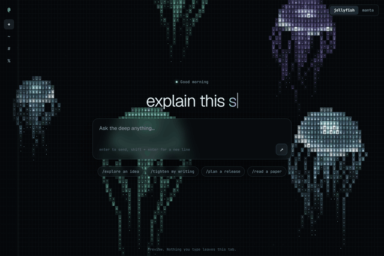
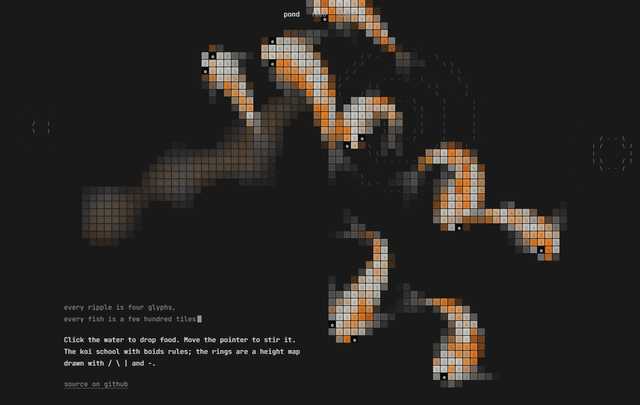
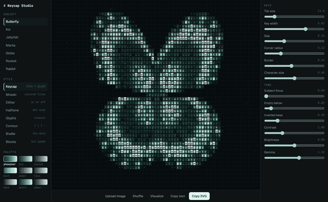
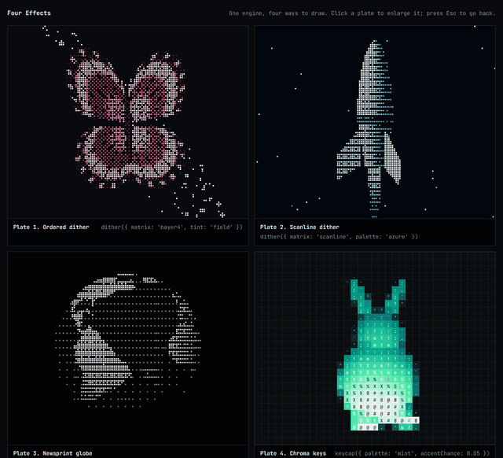
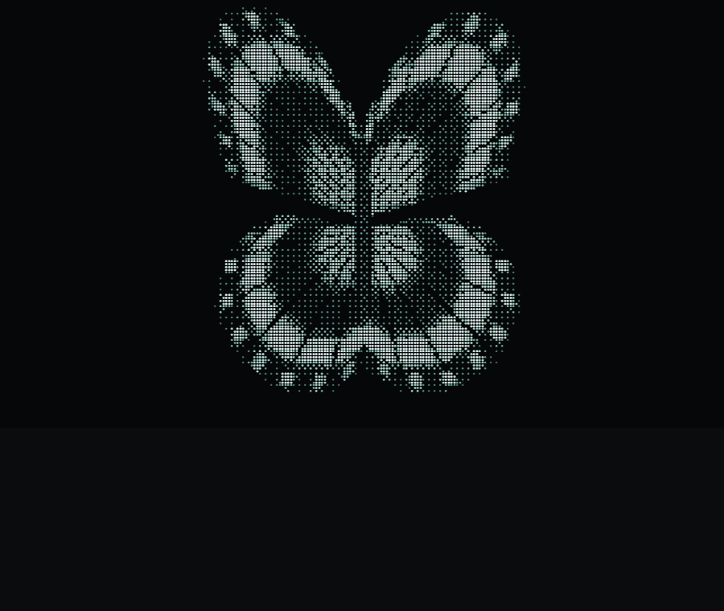
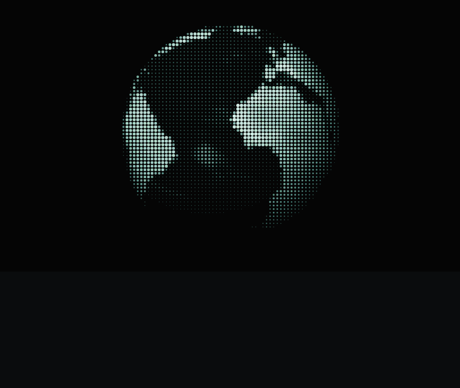

# ascii

A zero-dependency engine for making really good ASCII art: keycap tiles, ordered dither, halftone, contour glyphs, braille, and a tiny 3D rasterizer to feed them. It runs in the browser on a canvas and in Node as text, ANSI, SVG, or HTML.

| Deep Water | Koi Pond |
| --- | --- |
|  |  |

| Keycap Studio | Four Effects |
| --- | --- |
|  |  |

| Braille | Halftone |
| --- | --- |
|  |  |

## Install

```bash
npm install github:abhirajprasad/ascii
```

## Use it

### In the browser

```ts
import { deepWater, keycapAmbient, mount } from '@abhirajprasad/ascii';

const art = mount(document.querySelector('canvas'), {
  scene: deepWater({ creature: 'jellyfish', count: 5 }),
  style: keycapAmbient(),
});
```

`mount` handles sizing, device pixel ratio, pointer input, pausing when offscreen, and reduced motion. Style options are live: change `style.options.tile` and the next frame picks it up.

### From an image

```ts
import { imageScene, keycap, mount } from '@abhirajprasad/ascii';

mount(canvas, {
  scene: imageScene(imgElement), // or a <video> or another canvas
  style: keycap({ palette: 'ice', tile: 11, emptyBelow: 0.2, subjectFocus: 0.5 }),
});
```

### In Node

```ts
import { butterflyScene, glyphs, render, toAnsi, toSvg, toText } from '@abhirajprasad/ascii';

const style = glyphs({ aspect: 2, ramp: 'key' });
const { cells } = render({ scene: butterflyScene(), style, cols: 92, rows: 34, warmup: 3 });

console.log(toText(cells));                  // plain text
console.log(toAnsi(cells, style.look()));    // 24-bit terminal color
const svg = toSvg(cells, style.geometry(), style.look()); // poster-sharp vector
```

### From the command line

```bash
npx ascii play koi --style keycap
```

```bash
npx ascii still butterfly --style braille --palette rose
```

```bash
npx ascii image photo.png --style glyphs --cols 100 --format svg --out photo.svg
```

## Styles

| Style | What it does | Inspired by |
| --- | --- | --- |
| `keycap` | Rounded key plus glyph, all following tone. Dials for tile, key width, gap, radius, border, char size, subject focus, empty below, inverted keys | @kail_designs, @MarceloDesignX |
| `tiles` | Mosaic where the tile carries the scene's own color and the glyph is texture | @daoho04 |
| `contour` | Draws direction with `- / \| \`, one cell wide, from a height map or any image | @daoho04 |
| `dither` | Ordered dither with `bayer2`, `bayer4`, `bayer8`, and `scanline` matrices | @Skirook |
| `halftone` | Fixed grid, variable dot size | |
| `glyphs` | Classic colored text art with any ramp | |
| `braille` | 2x4 dots per character, the most detail a terminal can show | |
| `blocks` | 2x2 quadrant blocks, chunkier and more legible | |
| `layered` | Stacks any of the above | |

Presets: `keycapPoster`, `keycapAmbient`, `keycapChroma`, `pondStyle`, `ditherPrint`, `ditherCrt`, `ditherNewsprint`.

Palettes: `phosphor`, `ice`, `violet`, `mint`, `ember`, `rose`, `bone`, `azure`, `amber`, or `new Palette(name, stops)` with your own. All are sampled in OKLab.

## Scenes

Ready to use: `deepWater`, `pond`, `butterflyScene`, `rocketScene`, `globeScene`, `bunnyScene`, `imageScene`, `textScene`.

A scene is anything with a `render(field, t)`. Paint the field directly for procedural art:

```ts
const plasma = {
  render(f, t) {
    for (let row = 0, i = 0; row < f.rows; row++) {
      for (let col = 0; col < f.cols; col++, i++) {
        const v = 0.5 + 0.5 * Math.sin(f.cx(col) * 4 + t) * Math.cos(f.cy(row) * 4 - t);
        f.r[i] = f.g[i] = f.b[i] = v;
        f.a[i] = 1;
      }
    }
  },
};
```

Or draw real 3D. Meshes are rasterized at a few samples per cell, then filtered down, which is what gives silhouettes their soft edge:

```ts
import { ellipsoid, Layer, Pose } from '@abhirajprasad/ascii';

const sphere = ellipsoid();
const pose = new Pose();
let layer;

const planet = {
  resize(field) {
    layer = new Layer(field, 2);
  },
  render(field, t) {
    layer.clear();
    pose.set({ scale: 0.7, yaw: t });
    layer.drawMesh(sphere, pose, (frag) => {
      const light = Math.max(0, frag.nx * -0.4 + frag.ny * 0.5 + frag.nz * 0.77);
      frag.r = frag.g = frag.b = light;
    });
    layer.resolve();
  },
};
```

## The demos

Each one is a single self-contained file. They rebuild each post's look with the engine, using original scenes and copy.

| Demo | After | Try |
| --- | --- | --- |
| `deep-water` | [@MarceloDesignX](https://x.com/MarceloDesignX/status/2116030512267513983) | Switch between jellyfish and manta; the composer's glass blurs whatever swims behind it |
| `koi-pond` | [@daoho04](https://x.com/daoho04/status/2114490773043388518) | Click to feed the fish, move to stir the water, switch to the light theme |
| `keycap-studio` | [@kail_designs](https://x.com/kail_designs/status/2116100121020838226) | Upload a photo, turn every dial, then press Visualize for ten mockup layouts |
| `four-effects` | [@Skirook](https://x.com/Skirook/status/2116054882461659578) | Click a plate to enlarge it |

```bash
npm install
```

```bash
npm run dev
```

Then open http://localhost:5199.

## Develop

| Command | Does |
| --- | --- |
| `npm run dev` | Serves the demos and rebuilds on change |
| `npm run build` | Builds the library, CLI, types, and demos into `dist/` |
| `npm test` | Runs the test suite |
| `npm run typecheck` | Checks types |
| `npm run capture -- koi-pond --out pond.gif --frames 60` | Renders a demo in headless Chrome to a still or GIF, one stepped frame at a time |

## Learn the craft

[docs/CRAFT.md](docs/CRAFT.md) records what makes this art look good: why keys stay dark, why dither has to be ordered, how a ring becomes an octagon, and what a frame actually spends its time on.

## Credits

The looks here were studied from posts by [@MarceloDesignX](https://x.com/MarceloDesignX), [@kail_designs](https://x.com/kail_designs) of [ASCII Magic](https://ascii-magic.com), [@daoho04](https://x.com/daoho04), and [@Skirook](https://x.com/Skirook). This project isn't affiliated with any of them, and it shares no code or assets with their work.
